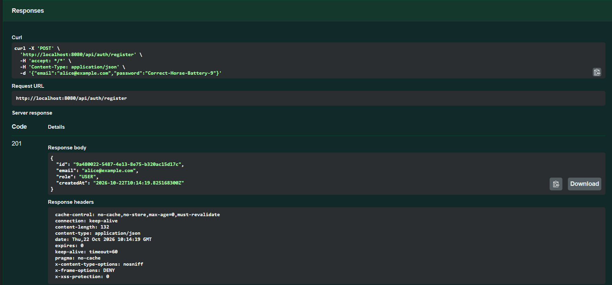
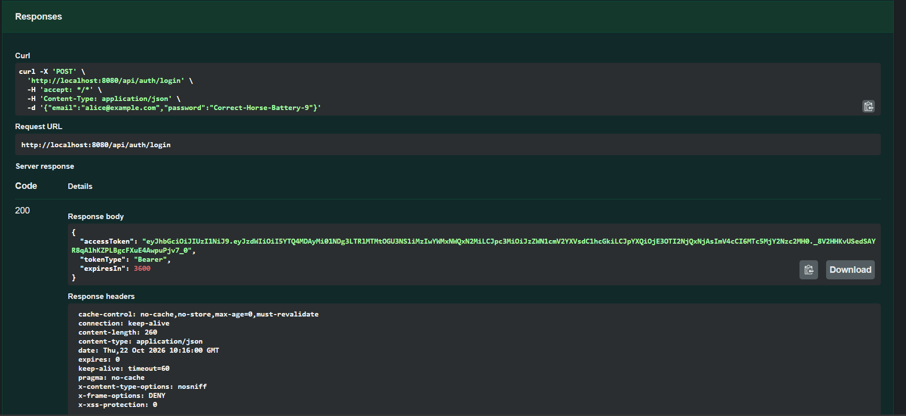
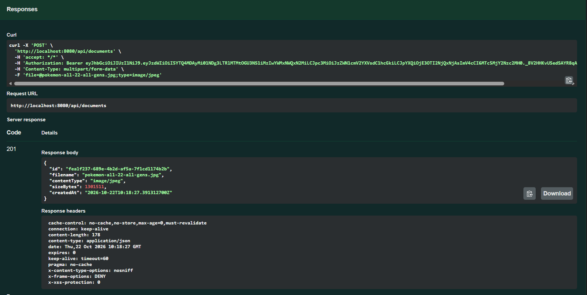
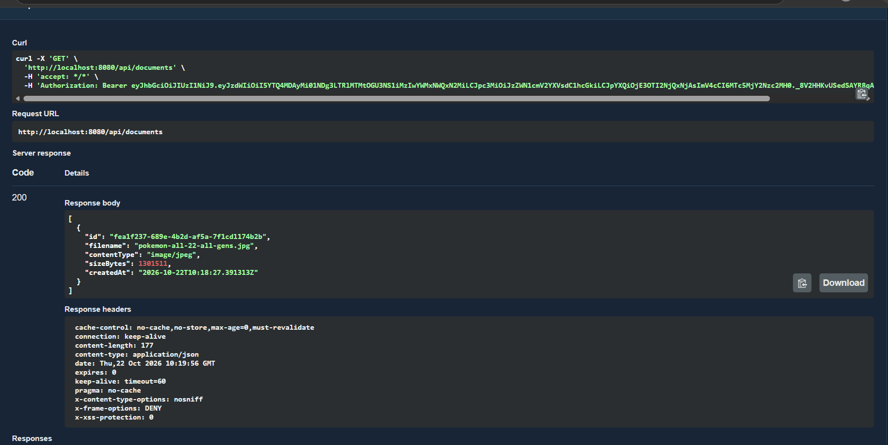
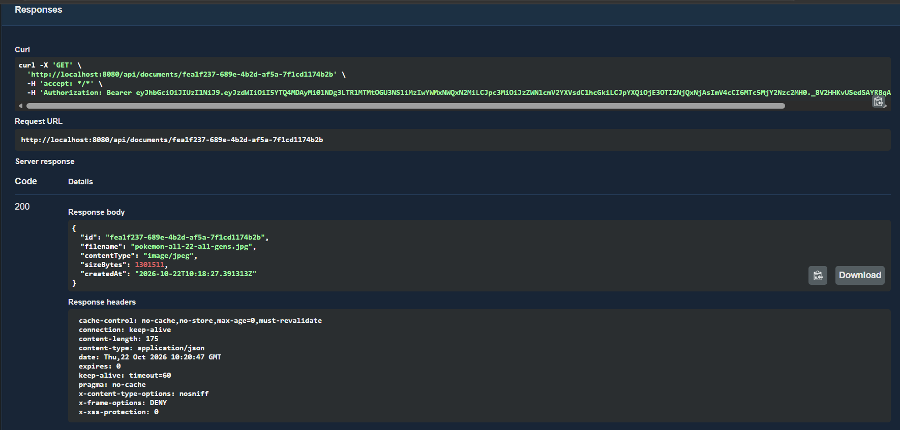
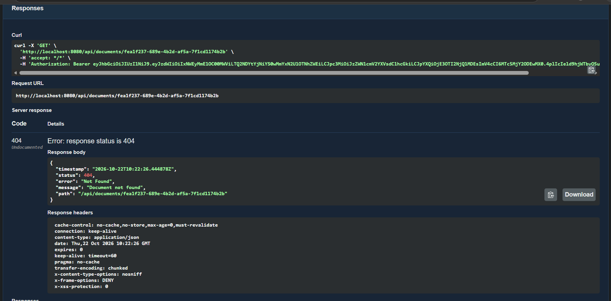
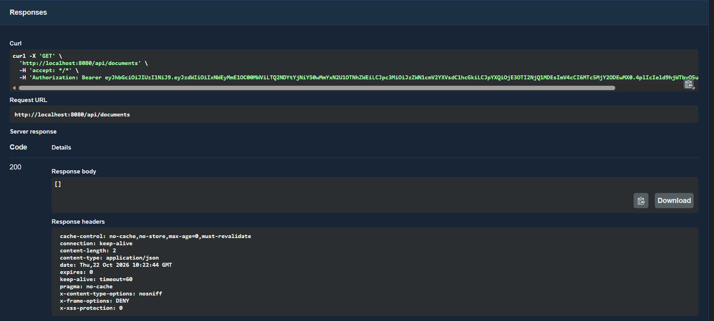
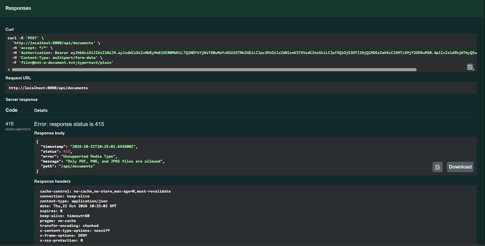
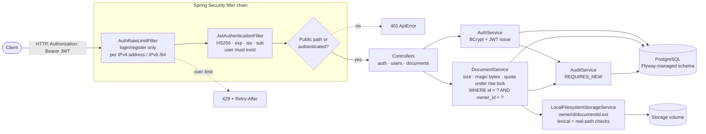
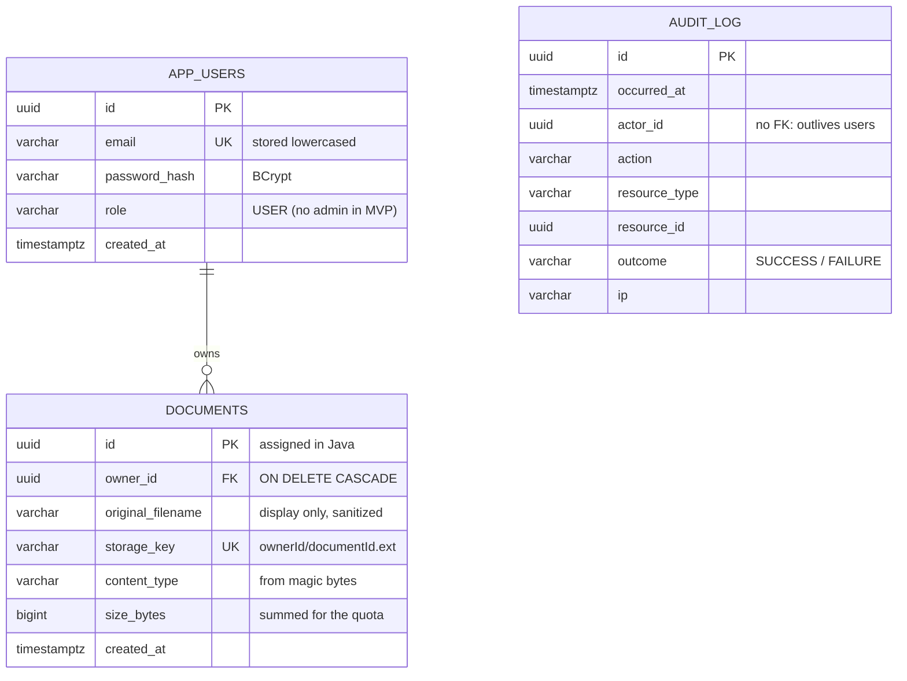

# SecureVault API

[](https://github.com/alxrxy/securevault-api/actions/workflows/ci.yml)

A security-focused document management REST API. Users register, log in
with a JWT, and upload, list, view, download, and delete **their own**
documents. The project is built around defending the usual weak spots of
file-handling APIs: broken object-level authorization (BOLA/IDOR), path
traversal, content-type spoofing, credential brute force, and information
leakage through errors.

**Status:** MVP complete. 95 tests pass (`mvn verify`, real PostgreSQL
via Testcontainers) locally and in GitHub Actions. An end-to-end
[demo script](#demo) exercises every flow against the running app. See
[`PROJECT_STATUS.md`](PROJECT_STATUS.md) for verified results and
[`PROJECT_SPEC.md`](PROJECT_SPEC.md) for the agreed design.

## Contents

[Stack](#stack) · [Getting started](#getting-started) · [Demo](#demo) ·
[API](#api) · [Screenshots](#screenshots) · [Architecture](#architecture) ·
[Security design](#security-design) · [Threat model](#threat-model) ·
[Testing](#testing) · [CI/CD](#cicd) · [Known tradeoffs](#known-tradeoffs) ·
[Known limitations](#known-limitations) · [Future improvements](#future-improvements)

## Stack

Java 21 · Spring Boot 4.1.1 (Spring Framework 7, Spring Security 7) ·
Spring Data JPA / Hibernate 7 · PostgreSQL 16 · Flyway · JJWT 0.13 ·
Bucket4j + Caffeine · springdoc-openapi 3.1 · JUnit 5 + Testcontainers ·
Docker / Docker Compose · GitHub Actions

## Getting started

Both options start from a `.env` file:

```bash
cp .env.example .env
# Edit .env. Set JWT_SECRET to the output of:  openssl rand -base64 48
# (the placeholder is deliberately invalid, so the app won't start with it)
# DB_PASSWORD=changeme is fine for local use only.
```

### Option A: run everything in Docker

Requires only Docker with Compose.

```bash
docker compose --env-file .env up -d --build    # PostgreSQL + API on :8080
curl http://localhost:8080/actuator/health       # {"groups":[...],"status":"UP"}
docker compose --env-file .env down              # stop (data stays in named volumes)
```

The image is a multi-stage build ([`Dockerfile`](Dockerfile)). It runs
as a non-root user (uid 10001) on a JRE-only Alpine base, pinned by
digest. Compose runs it with a read-only root filesystem, no Linux
capabilities, and `no-new-privileges`. Uploaded files go to the
`securevault-storage` volume.

### Option B: local development with Maven

Requires Java 21, Maven 3.9+, and Docker (for PostgreSQL).

```bash
docker compose --env-file .env up -d postgres   # only the database, on :5432

# Maven doesn't read .env, so export it first.
set -a; . ./.env; set +a                         # bash/zsh
mvn spring-boot:run                              # API on :8080
```

PowerShell equivalent of the export step:
`Get-Content .env | Where-Object { $_ -match '^\w+=' } | ForEach-Object { $k, $v = $_ -split '=', 2; Set-Item "env:$k" $v }`

Flyway creates the schema on first start (`V1__init.sql`, `V2__audit_log.sql`).

### Configuration

| Variable | Default | Purpose |
|---|---|---|
| `JWT_SECRET` | **none (required)** | Base64 HMAC key, ≥ 32 bytes decoded. `openssl rand -base64 48` |
| `DB_PASSWORD` | **none (required)** | PostgreSQL password. The app and Compose refuse to start without it |
| `JWT_EXPIRATION_MINUTES` | `60` | Access-token lifetime |
| `DB_HOST` / `DB_PORT` / `DB_NAME` / `DB_USERNAME` | `localhost` / `5432` / `securevault` / `securevault` | PostgreSQL location and user (Compose sets `DB_HOST=postgres` for the app container) |
| `AUTH_RATE_LIMIT_PER_MINUTE` | `10` | Login + register requests per client (IPv4 address or IPv6 /64) |
| `STORAGE_ROOT` | `./data/storage` (`/data/storage` in the image) | Where uploaded files are written; keep it outside any web-served directory |
| `STORAGE_QUOTA_PER_USER` | `1GB` | Total bytes of documents one user may store (`500MB`, `5GB`, ...) |
| `SERVER_PORT` | `8080` | HTTP port (host port in Compose) |

Missing required settings stop startup immediately with a message naming
the variable, e.g. `Could not resolve placeholder 'DB_PASSWORD'`.

## Demo

[`demo/demo.ps1`](demo/demo.ps1) runs the whole story against a live
instance and checks every status code. It covers register, login,
upload, list, download (attachment + `nosniff` + byte-for-byte check),
another user getting 404s, a duplicate email (409), a disguised HTML
file (415), a 25 MB + 1 byte upload (413), filling the storage quota
(409), and brute-forcing a password (429). It works on Windows
PowerShell 5.1 and PowerShell 7+ (`pwsh` on macOS and Linux).

```powershell
# Start the API with a small quota so the quota step can trigger, e.g. in .env:
#   STORAGE_QUOTA_PER_USER=1MB
./demo/demo.ps1                     # or: ./demo/demo.ps1 -BaseUrl http://localhost:9090
```

Real output against the Docker stack:

```text
[PASS] Register alice                         201  alice-e4bc761b@example.com
[PASS] Register bob                           201
[PASS] Register alice again (any case) -> 409 409  An account with this email already exists
[PASS] Login alice                            200  JWT issued
[PASS] Login bob                              200  JWT issued
[PASS] Upload report.pdf (alice)              201
[PASS] List documents (alice)                 200  1 document(s)
[PASS] Download (alice)                       200  attachment; filename="report.pdf"; filename*=UTF-8''report.pdf; nosniff=nosniff; bytes identical=True
[PASS] Bob reads alice's document -> 404      404  Document not found
[PASS] Bob downloads alice's document -> 404  404
[PASS] Bob deletes alice's document -> 404    404
[PASS] Bob's list is empty                    200  []
[PASS] HTML disguised as invoice.pdf -> 415   415  Only PDF, PNG, and JPEG files are allowed
[PASS] Upload 25 MB + 1 byte -> 413           413  File exceeds the upload size limit
[PASS] Exceed storage quota -> 409 (after 2 chunk(s)) 409  Upload would exceed your storage quota (821248 of 1048576 bytes used, this file is 409600 bytes)
[PASS] Delete report.pdf (alice)              204
[PASS] Wrong passwords -> 429 (attempt 7)     429  Retry-After: 5s

All steps behaved as expected.
```

Login and register share a 10-per-minute budget per client, and the
script uses it up on purpose, so wait a minute between runs. For
clicking through requests one at a time, there's also
[`demo/securevault.http`](demo/securevault.http) for the VS Code REST
Client extension, which uploads [`demo/sample.pdf`](demo/sample.pdf).

## API

Interactive docs are at **`/swagger-ui.html`** and the OpenAPI spec is at
**`/v3/api-docs`**. In Swagger UI, click **Authorize** and paste a token
from `/api/auth/login`.

| Method | Path | Auth | Success | Notes |
|---|---|---|---|---|
| POST | `/api/auth/register` | public | 201 | `{email, password}`; password 12–72 chars (≤ 72 UTF-8 bytes) |
| POST | `/api/auth/login` | public | 200 | → `{accessToken, tokenType: "Bearer", expiresIn}` |
| GET | `/api/users/me` | bearer | 200 | Current user (never includes the password hash) |
| POST | `/api/documents` | bearer | 201 | `multipart/form-data`, field `file`; PDF/PNG/JPEG only, ≤ 25 MB, within your storage quota |
| GET | `/api/documents` | bearer | 200 | Your documents, newest first |
| GET | `/api/documents/{id}` | bearer | 200 | Metadata |
| GET | `/api/documents/{id}/download` | bearer | 200 | Always an attachment |
| DELETE | `/api/documents/{id}` | bearer | 204 | Removes the row and the stored file, freeing its quota |
| GET | `/actuator/health` | public | 200 | The only actuator endpoint exposed |

Every error returns the same shape, with no stack traces or internal
details:

```json
{"timestamp":"…","status":404,"error":"Not Found","message":"Document not found","path":"/api/documents/…"}
```

| Status | When |
|---|---|
| 400 | Invalid input, malformed id, empty file, malformed multipart |
| 401 | Missing/invalid token, or wrong email/password on login |
| 404 | Document doesn't exist **or belongs to someone else** (deliberately indistinguishable) |
| 409 | Email already registered, **or** the upload would push you over your storage quota |
| 413 | A single file is over 25 MB |
| 415 | File content isn't PDF, PNG, or JPEG |
| 429 | Too many login/register requests from your address (`Retry-After` header) |

**413 vs. 409 on upload:** 413 means *this file* is too large (over the
25 MB per-file limit), whatever you have stored. 409 means the file is
acceptable on its own, but your stored documents plus this one would
exceed `STORAGE_QUOTA_PER_USER`. The message says how much you've used.
Deleting documents frees quota.

curl example:

```bash
B=http://localhost:8080
curl -s -H 'Content-Type: application/json' -d '{"email":"me@example.com","password":"a-long-passphrase"}' $B/api/auth/register
TOKEN=$(curl -s -H 'Content-Type: application/json' -d '{"email":"me@example.com","password":"a-long-passphrase"}' $B/api/auth/login | jq -r .accessToken)
curl -s -H "Authorization: Bearer $TOKEN" -F "file=@report.pdf" $B/api/documents
curl -s -H "Authorization: Bearer $TOKEN" $B/api/documents
```

## Screenshots

Captured in Swagger UI against a local instance. Two users, Alice and
Bob; the tokens shown were short-lived local test tokens.

| | |
|---|---|
| **1. Register** returns 201 with the new user and no password hash.<br> | **2. Login** returns 200 with a bearer JWT (HS256, 60-minute expiry).<br> |
| **3. Upload** returns 201. The content type comes from the file's bytes, not the client.<br> | **4. List** shows only Alice's own documents.<br> |
| **5. Get** returns metadata only, with no storage path or owner id.<br> | **6. Cross-user access:** Bob requests Alice's document id and gets 404, exactly like a missing document.<br> |
| **7. Bob's list** is empty; ownership is enforced in the query.<br> | **8. Wrong type:** a `.txt` upload is rejected with 415 after content sniffing.<br> |

Swagger labels the 404 and 415 responses "Undocumented" because error
responses aren't declared in the OpenAPI spec yet (see
[Future improvements](#future-improvements)).

## Architecture

Request flow:



Data model (Flyway migrations
[`V1__init.sql`](src/main/resources/db/migration/V1__init.sql) and
[`V2__audit_log.sql`](src/main/resources/db/migration/V2__audit_log.sql)):



`audit_log` deliberately has no foreign keys, so records survive the
deletion of the users and documents they describe.

| Package | Contents |
|---|---|
| `auth` | Register/login controller, DTOs, `AuthService` |
| `user` | `AppUser` entity, repository (incl. the row lock used by the quota), `GET /api/users/me` |
| `document` | `Document` entity, owner-scoped repository, `DocumentService`, controller, `AllowedFileType` (magic bytes) |
| `storage` | `StorageService` interface and the path-safe local filesystem implementation |
| `security` | `SecurityConfig`, `JwtService`, JWT filter, rate-limit filter, entry point |
| `audit` | `audit_log` entity, repository, `AuditService` |
| `exception` | `ApiError` and `GlobalExceptionHandler` |
| `config` | OpenAPI metadata (bearer scheme), `RequiredSecretsInitializer` (fail-fast on missing secrets) |

## Security design

- **Stateless JWT, not sessions.** This is a pure REST API, and a bearer
  token in the `Authorization` header is never attached automatically by
  a browser. That is why CSRF protection is disabled; the full reasoning
  is in `SecurityConfig`. Tokens are HS256 only. Each one is checked for
  signature, algorithm, expiry (30 s clock skew), issuer, and subject, and
  the user must still exist.
- **Protected by default.** Only the endpoints in an explicit allow-list
  are public.
- **Ownership is enforced in the query, not afterwards.** There is no code
  path that loads a document by id alone. The owner always comes from the
  token, never from the request.
- **Uploads are identified by their bytes.** The client's `Content-Type`
  and filename extension are ignored. The stored type and the on-disk
  extension come from magic-byte detection.
- **Storage paths are server-generated** and checked twice: once
  lexically, and once against the real path after following symlinks.
  The original filename is display-only and is sanitized.
- **Per-user storage quota,** enforced under a row lock so concurrent
  uploads can't overshoot it.
- **Downloads are always attachments,** with the detected `Content-Type`
  and `X-Content-Type-Options: nosniff`. The filename is RFC 5987-encoded.
- **Audit trail.** Login, registration, upload, download, and delete
  events are recorded on success and failure, with the actor, target, and
  IP. Failure records survive the rollback of the action they describe.
  Tokens, passwords, attempted emails, and file contents are never logged.
- **No secrets in the repo or in defaults.** `JWT_SECRET` and
  `DB_PASSWORD` have no fallback values, and the test suite generates its
  signing key at runtime.
- **Schema owned by Flyway** (`ddl-auto: validate`).

## Threat model

**Assets:** users' documents, account credentials, and the JWT signing key.
**Actors:** anonymous internet clients, authenticated users acting
against other users, and an attacker with a stolen token.
**Trust boundary:** the HTTP interface. Nothing in a request (headers,
filenames, content types, ids, `X-Forwarded-For`) is trusted.

| Threat | Mitigation | Verified by |
|---|---|---|
| Accessing another user's document by id (BOLA/IDOR) | Owner-scoped queries; 404 identical to a missing document; denied attempts audited | `SecurityRegressionTest`, `DocumentIntegrationTest` (fail if ownership is removed) |
| Forged or altered tokens (`alg: none`, algorithm switch, wrong key, swapped subject, expired, wrong issuer) | Pinned HS256 plus full claim validation; failures return a generic 401 | 13 credential variants × every document endpoint |
| Password brute force / credential stuffing | Per-client bucket (IPv4 address, IPv6 /64) matched on the decoded path; `X-Forwarded-For` ignored | `AuthRateLimitTest`, `AuthRateLimitFilterTest`, path-variant tests |
| Login user enumeration | Unknown email and wrong password give the same 401; Spring's `DaoAuthenticationProvider` runs a dummy BCrypt check for unknown emails (timing not measured here) | `AuthIntegrationTest` |
| Path traversal / symlink escape in storage | Server-generated keys; lexical check plus real-path check; `CREATE_NEW` and `NOFOLLOW_LINKS` on write | `LocalFilesystemStorageServiceTest` |
| Malicious content served from the API origin (stored XSS) | Allow-list of types by magic bytes; attachment-only downloads; `nosniff`; detected `Content-Type`; extension forced to match the type | `AllowedFileTypeTest`, `DocumentIntegrationTest` |
| Header injection via filename | Control characters stripped; RFC 5987 `Content-Disposition` | `DocumentIntegrationTest` |
| Information leakage in errors | Fixed client messages; details logged server-side only; only `health` exposed on actuator | `serverErrorsDoNotLeakInternals`, `onlyHealthActuatorEndpointIsExposed` |
| Repudiation | `audit_log` written with `REQUIRES_NEW` | `AuditLogIntegrationTest` (fails if propagation is `REQUIRED`) |
| Resource exhaustion (huge uploads, filling the disk, rate-limiter memory) | 25 MB per file (servlet + service); per-user quota enforced under a row lock; bucket cache bounded and expiring | `StorageQuotaIntegrationTest` (fails without the lock), plus the demo's 413 step |
| Running with default or missing secrets | No fallbacks for `JWT_SECRET` / `DB_PASSWORD`; fail fast before any bean starts | `RequiredSecretsInitializerTest` |
| Container breakout / privilege abuse | Non-root uid, read-only root fs, `cap_drop: ALL`, `no-new-privileges` | Checked manually (`docker exec … id`, write attempt on `/app`) |
| Insecure code patterns (injection, unsafe deserialization, path handling, ...) | CodeQL default security suite on every push/PR and weekly | CI (Security → Code scanning) |
| Committed credentials | GitHub secret scanning + push protection; no secret defaults; test key generated at runtime | Repository settings |
| Vulnerable dependencies | Dependabot; Dependency Review blocks high/critical on PRs | CI |

## Testing

```bash
mvn verify                                      # everything: compile, 95 tests, package (Docker must be running)
mvn test -Dtest=SecurityRegressionTest          # one class
mvn test -Dtest='StorageQuotaIntegrationTest#concurrentUploadsCannotOvershootQuota'   # one test
```

Integration tests boot the full application against a real PostgreSQL
16 started by Testcontainers, with Flyway migrations and Hibernate schema
validation. One container is shared by the whole run. Nothing is mocked
below the HTTP layer.

| Test class | Tests | What it proves |
|---|---|---|
| `SecurityRegressionTest` | 31 | 13 invalid-credential variants × all 5 document endpoints → 401 with no side effects; cross-user access on every endpoint; client-supplied `ownerId` ignored; malformed/unknown ids; malformed uploads; no internals in 500 bodies; percent-encoded and other path variants can't dodge the rate limit; only `health` exposed on actuator |
| `JwtAuthenticationFilterTest` | 10 | Valid, expired, tampered, foreign-key, HS384, unsigned, wrong-issuer, no-subject, and unknown-user tokens |
| `AuthIntegrationTest` | 10 | Registration (normalization, duplicates, validation, BCrypt byte limit), login, generic 401s, `/api/users/me` |
| `DocumentIntegrationTest` | 10 | Upload type sniffing and server-generated paths, 415/400/413, owner-only list, cross-user 404, download headers, delete removes the file, auditing |
| `AuthRateLimitFilterTest` | 8 | Bucket cache eviction and size bound (fake clock), IPv6 /64 keying, IPv4-mapped addresses, `X-Forwarded-For` ignored |
| `StorageQuotaIntegrationTest` | 6 | Quota boundary, 409, delete frees space, per-user isolation, rejection leaves no file, **8 concurrent uploads can't overshoot** |
| `LocalFilesystemStorageServiceTest` | 5 | Round trip, no overwrite, `../` and absolute keys rejected, **symlink/junction escape rejected** |
| `RequiredSecretsInitializerTest` | 4 | Startup fails naming `DB_PASSWORD` / `app.jwt.secret` when missing |
| `AuditLogIntegrationTest` | 3 | Success/failure events, and failure rows **surviving the transaction rollback** |
| `AuthRateLimitTest` | 3 | 429 + `Retry-After` over HTTP, shared login/register bucket, per-client isolation |
| `AllowedFileTypeTest` | 3 | PDF/PNG/JPEG magic bytes accepted; HTML, GIF, ZIP, and truncated signatures rejected |
| `ApiDocsIntegrationTest` | 2 | OpenAPI declares bearer auth (public endpoints opt out); Swagger UI is served |

**Mutation checks.** For each critical control, the code was broken on
purpose (for example, removing the owner filter from the document query,
switching audit writes from `REQUIRES_NEW` to `REQUIRED`, or removing the
quota row lock). I confirmed the targeted test then failed and restored
the code. This shows the tests detect the bug they exist for rather than
passing by accident. The full table is in
[`PROJECT_STATUS.md`](PROJECT_STATUS.md#mutation-checks). As one example,
without the row lock all 8 concurrent 300-byte uploads succeeded against
a 1 KB quota.

## CI/CD

| Workflow / config | Runs on | What it does |
|---|---|---|
| [`ci.yml`](.github/workflows/ci.yml) | push and PR to `main` | `mvn -B -ntp verify` on JDK 21 Temurin with a Maven cache: compile, all tests (Testcontainers uses the runner's Docker), package |
| [`codeql.yml`](.github/workflows/codeql.yml) | push and PR to `main`, weekly | CodeQL static analysis of the Java code (default high-precision security query suite, deliberately not `security-extended`, to avoid false-positive noise); results appear under **Security → Code scanning** |
| [`dependency-review.yml`](.github/workflows/dependency-review.yml) | PRs to `main` | Fails the PR if it adds a dependency with a known **high or critical** vulnerability |
| [`dependabot.yml`](.github/dependabot.yml) | weekly | Update PRs for Maven (minor/patch grouped into one PR), GitHub Actions, and the Dockerfile base images |
| Secret scanning + push protection | every push | Enabled in the repository settings; pushes containing recognized credentials are blocked |

Supply-chain hardening:
- **Actions are pinned to full commit SHAs** (with the version in a
  comment), not tags. A tag can be moved to malicious code; a commit
  SHA can't. Dependabot keeps the SHAs current.
- **Docker base images are pinned by digest** for the same reason.
- Workflows run with `permissions: contents: read`, and checkout uses
  `persist-credentials: false`. Only the CodeQL job gets
  `security-events: write`, which it needs to upload results.

## Known tradeoffs

- **Registration reveals whether an email is registered.** `POST
  /api/auth/register` returns `409 Conflict` for an existing email, so
  anyone can probe which addresses have accounts. Login does *not* leak
  this. The tradeoff is accepted for the MVP because the alternative
  (always return the same response and notify the address owner out of
  band) needs an email-delivery flow that is out of scope. Mitigations:
  the per-client rate limit on `/api/auth/register` slows bulk probing,
  and every duplicate attempt is recorded in `audit_log`
  (`REGISTER`/`FAILURE`).
- **API docs are public.** `/swagger-ui.html` and `/v3/api-docs` describe
  the API without authentication. Every operation they list is still
  protected. To turn them off, set `springdoc.api-docs.enabled=false` and
  `springdoc.swagger-ui.enabled=false`.
- **The Docker image build skips tests.** Tests need a Docker daemon
  (Testcontainers), so they run in CI (`mvn verify`), not inside
  `docker build`.

## Known limitations

- **Polyglot files.** Type detection checks the leading magic bytes only,
  so a file can begin with a valid PDF/PNG/JPEG signature and carry other
  content after it. This is contained by attachment-only downloads,
  `nosniff`, and the server-detected `Content-Type`. Full format
  validation or re-encoding is out of MVP scope.
- **Orphaned files.** If the database insert fails after a file is
  stored, the file is deleted. If deleting a file fails after its row was
  removed, the file stays on disk and a warning is logged. There is no
  cleanup job.
- **The storage quota is per user, not global.** It caps each account,
  but many accounts can still fill the disk together, and registration
  is only rate-limited per client address. Usage is counted from
  document metadata. Orphaned files (see above) are not counted. The
  same quota applies to every user; there are no per-account overrides.
- **Uploads aren't rate-limited.** Only login and register are. Uploads
  are bounded by the 25 MB per-file limit and the quota.
- **No token revocation.** Tokens stay valid until they expire (default
  60 minutes). There is no logout or refresh token. Rotating `JWT_SECRET`
  invalidates every token.
- **The rate limit is in-memory and keyed on the direct peer address.**
  It resets on restart and isn't shared across instances. Behind a
  reverse proxy, **or when the app runs in Docker** (every host request
  arrives from the bridge gateway, e.g. `172.18.0.1`), all clients
  share one bucket. That fails safe, but it means one noisy client can
  rate-limit everyone. Trusted-proxy handling is needed before a real
  deployment.
- **Bearer scheme case.** The `Authorization` scheme must be written
  exactly `Bearer`. A lowercase `bearer` is rejected (fail-closed),
  although RFC 6750 allows any case.
- **Single node, local filesystem storage.**
- **CI caveat.** The Dependency Review Action needs the repository's
  dependency graph enabled. On private repositories it also needs GitHub
  Advanced Security.

## Future improvements

- **Document error responses in the OpenAPI spec** (400/401/404/409/413/415/429
  with the `ApiError` schema), so Swagger stops labelling them "Undocumented".
- **Trusted-proxy support** for the rate limiter (honor `X-Forwarded-For`
  only from configured proxy addresses), plus a Redis-backed Bucket4j
  store for multiple instances.
- **Token lifecycle:** short-lived access tokens with refresh tokens,
  logout, and server-side revocation.
- **Upload abuse controls:** a rate limit on uploads, a global storage
  cap, and per-account quota overrides.
- **Storage robustness:** a cleanup job for orphaned files, and S3 (or
  compatible) storage behind the existing `StorageService` interface.
- **Deeper file validation:** full format parsing or re-encoding of
  images/PDFs to neutralize polyglots, and malware scanning.
- **Registration without enumeration:** email verification so the
  duplicate-email response can be uniform.
- **Deferred in the spec:** an admin role and an audit-log read endpoint,
  document versioning, per-account login lockout, and cloud deployment.
- **Build convenience:** a Maven wrapper (`./mvnw`) so contributors
  don't need Maven installed.

## License

Personal portfolio project.
